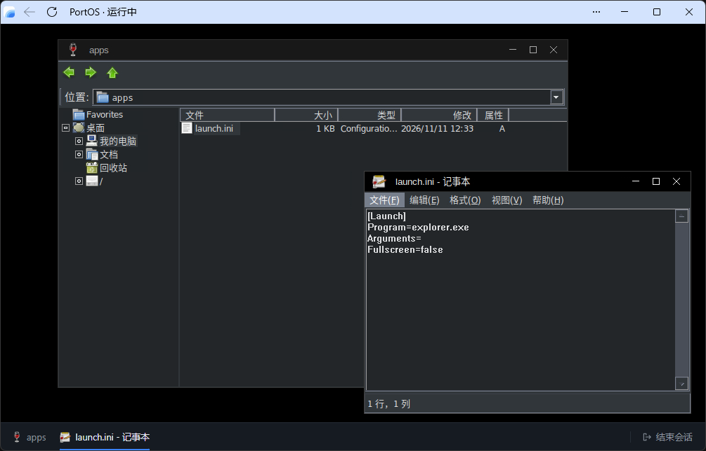

<h1>&nbsp;&nbsp;PortOS</h1>

PortOS 用于在线展示 Windows 程序和交互作品。

程序通过 Wine 在服务器的独立容器中运行，访客打开浏览器即可操作。会话结束后，容器会自动回收，访客的改动随会话清除。



## 部署

准备好 Docker 和 Docker Compose v2。Windows 上使用 Docker Desktop 的 Linux 容器模式。

在项目根目录启动。Windows 运行 `.\build.bat` 构建并启动网关，重建时会清理已有会话。Linux 运行以下命令。

```sh
make build
make up
```


本机访问 `http://localhost:8081`，局域网内访问 `http://<服务器 IP>:8081`。默认打开 Wine 自带的资源管理器。

## 展示自己的程序

将 `.exe` 放在 `apps/` 根目录，并按程序需要的目录结构放好 DLL、配置和数据文件。编辑 [apps/launch.ini](apps/launch.ini)，将 `Program` 改为 EXE 文件名。

```ini
[Launch]
Program=MyApp.exe
Arguments=
Fullscreen=false
```

`Arguments` 可填写启动参数，`Fullscreen=true` 会让程序铺满远程桌面。

修改 `apps/` 中的程序文件后，新建的会话容器会复制最新文件。已在运行的会话和预热容器会继续使用原来的文件。


## 常用配置

按需复制 [.env.example](.env.example) 为 `.env`，修改后重新启动网关。

配置信息详见 [.env.example](.env.example)，正常情况下使用默认值即可。

公网部署时，可将 `PORTOS_BIND` 设为 `127.0.0.1`，在同一宿主机上用支持 WebSocket 的 HTTPS 反向代理转发到网关。

## 网关日志

运行 `docker compose logs -f gateway` 查看日志，日志会记录访问者IP、停留时间和浏览器UA。

访问者IP优先记录 `X-Real-IP`，请求头缺失或无效时记录 TCP 对端 IP。使用 Nginx 时，由公网入口用 `proxy_set_header X-Real-IP $remote_addr;` 覆盖客户端传来的值。
